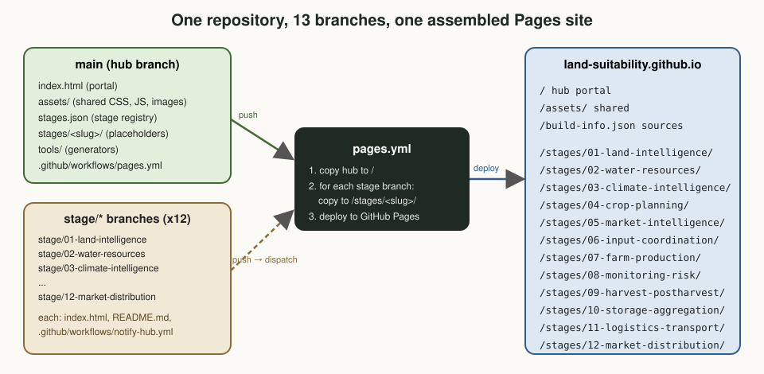

# Amhara Integrated Agriculture Ecosystem (AIAE)

**From Land Intelligence to Market Delivery.**
Website: https://land-suitability.github.io

An end-to-end agricultural ecosystem concept, piloted in the Amhara Region of Ethiopia, that connects
land, water, climate, crops, farmers, markets, infrastructure, transport and customers into one
coordinated value chain. Core principle: plan backwards from the market to the land, then execute
forwards from land preparation to the final customer.

## Repository architecture

Each of the 12 stages of the operating chain has its own branch and its own page.



| Branch | Content | Published at |
|---|---|---|
| `main` (hub) | Portal, shared design system, `stages.json`, tools, Pages workflow | `/` |
| `stage/01-land-intelligence` | Stage 01 content | `/stages/01-land-intelligence/` |
| `stage/02-water-resources` | Stage 02 content | `/stages/02-water-resources/` |
| `stage/03-climate-intelligence` | Stage 03 content | `/stages/03-climate-intelligence/` |
| `stage/04-crop-planning` | Stage 04 content | `/stages/04-crop-planning/` |
| `stage/05-market-intelligence` | Stage 05 content | `/stages/05-market-intelligence/` |
| `stage/06-input-coordination` | Stage 06 content | `/stages/06-input-coordination/` |
| `stage/07-farm-production` | Stage 07 content | `/stages/07-farm-production/` |
| `stage/08-monitoring-risk` | Stage 08 content | `/stages/08-monitoring-risk/` |
| `stage/09-harvest-postharvest` | Stage 09 content | `/stages/09-harvest-postharvest/` |
| `stage/10-storage-aggregation` | Stage 10 content | `/stages/10-storage-aggregation/` |
| `stage/11-logistics-transport` | Stage 11 content | `/stages/11-logistics-transport/` |
| `stage/12-market-distribution` | Stage 12 content | `/stages/12-market-distribution/` |

GitHub Pages publishes one site per repository, so `.github/workflows/pages.yml` on the hub assembles
the hub and every stage branch into a single site. Each stage branch carries a small
`notify-hub.yml` workflow that triggers a rebuild whenever that branch is pushed. A stage without a
branch yet is served from its placeholder in `stages/<slug>/` on the hub.

## Branch working rules

Before changing anything, read **[docs/BRANCHING.md](docs/BRANCHING.md)** (which branch a change goes to,
the rules, recipes and checklists) and run `python3 tools/check_branch.py` before every push.

## Layout of the hub branch

```
index.html                     portal: illustrated landscape with stage hotspots, questions, wheel, stage grid
how-it-works.html              one season told in 13 steps with a scrolling season clock
data-spine.html                interactive arc diagram of every hand-off between stages
glossary.html                  plain-language glossary with search
tools.html                     index of the twelve stage calculators ("Try it" sections)
assets/data/glossary.json      glossary terms (used by glossary.html and for in-text definitions on stage pages)
findings.html                  one chart per stage demo result (synthetic data)
pilot-map.html                 illustrated, layered map of a fictional pilot woreda
people.html                    who does what: ten roles and the stages they lead or support
roadmap.html                   Phase 1 build roadmap: four modules, built one at a time
contact.html                   collaboration form (posts to Formspree; the endpoint is the form's action)
brief.html                     two-page concept brief (rendered to assets/AIAE-concept-brief.pdf)
404.html, robots.txt, sitemap.xml
stages.json                    single source of truth: project, domains, 12 stages
assets/css/site.css            shared design system (light and dark theme, all components)
assets/js/site.js              shared behaviour for every page, including stage branches (see below)
assets/js/hub.js               hub only: landscape hotspots and the value-chain wheel
assets/img/icons.svg           icon sprite: 12 stage icons (i-01..i-12), 4 domain icons, UI icons
assets/img/stages/<slug>.svg   one illustration per stage (generated)
assets/img/social/<slug>.jpg   one link-preview card per stage (generated)
assets/img/                    hero landscape, diagrams, favicon, hub social card
stages/<slug>/index.html       generated placeholder page for each stage
templates/stage.html           template for stage pages
templates/stage-branch/        files seeded into every new stage branch
tools/build_site.py            validate stages.json, regenerate grid and placeholders
tools/make_stage_art.py        regenerate the twelve stage illustrations
tools/make_hub_diagrams.py     redraw the three hub diagrams (--check measures every label)
tools/make_tools_page.py       rebuild tools.html (calculators index)
tools/make_findings_page.py    rebuild findings.html (one chart per stage demo)
tools/make_pilot_map.py        rebuild pilot-map.html and assets/img/pilot-map.svg
tools/make_people_page.py      rebuild people.html and assets/img/people-row.svg
tools/make_roadmap_page.py     rebuild roadmap.html (edit MODULES as each module lands)
tools/sweep_pages.js           check every page for JS errors, failed requests, overflow and broken images
tools/render_media.js          regenerate social cards and the brief PDF (Playwright)
tools/create_stage_branches.py create the 12 orphan stage branches
tools/check_branch.py          pre-push checker for the branch rules
docs/BRANCHING.md              branch working rules, recipes and checklists
.github/workflows/pages.yml    assemble all branches and deploy
```

## What every page gets from the shared files

Stage branches link `/assets/css/site.css` and `/assets/js/site.js`, so these features reach all
twelve stage pages without editing the branches:

- Quick-jump and search palette (Ctrl+K, "/" or the Jump button), searching inside every stage page
- Theme toggle (light and dark), reading-progress bar, back-to-top button, reveal-on-scroll
- On stage pages: the chain navigator strip, the stage illustration beside the hero, scroll spy on
  the table of contents, and previous/next cards (stage 12 wraps to 01)
- Click-to-enlarge lightbox for every `figure.diagram img`; keyboard-focusable scrollable tables
- Shared logo and favicon
- On stage pages: glossary terms explained in context (first mention, from `assets/data/glossary.json`),
  numbered methods, an illustrated strip in the Amhara section, and links from the "Try it" and demo
  sections to the calculators and findings pages
- Copy buttons on code blocks; identifiers and short values in tables never break mid-word
- Keyboard shortcuts: `?` for help, `t` for theme, `[` and `]` for previous and next stage

## Visitor statistics

Visits are counted with [GoatCounter](https://www.goatcounter.com): no cookies, no personal data,
so no consent banner is needed. The switch is one line in `assets/js/site.js`:
`var GOATCOUNTER_CODE = "aiae";` (empty = off; dashboard: aiae.goatcounter.com). Counting runs only on `land-suitability.github.io`, never on
local copies or previews, and covers every page including the stage branches (they load `site.js`).
Successful collaboration requests are recorded as the event `collaboration-request-sent`.

## Common tasks

```bash
# Validate the stage registry
python3 tools/build_site.py --check

# After editing stages.json: regenerate the hub grid and placeholder pages
python3 tools/build_site.py

# Create the stage branches (skips any that already exist), then push them
python3 tools/create_stage_branches.py --push

# Regenerate stage illustrations, social cards and the brief PDF
python3 tools/make_stage_art.py
node tools/render_media.js

# Preview locally (absolute /assets paths need a server at the repo root)
python3 -m http.server 8000   # then open http://localhost:8000
```

## One-time GitHub setup

1. Make `main` the default branch: Settings → General → Default branch → switch to `main` → Update.
   Check it with `git ls-remote --symref origin HEAD` (must print `ref: refs/heads/main`).
2. Settings → Pages → Build and deployment → Source: **GitHub Actions**.
3. Settings → Actions → General → Workflow permissions: allow workflows to run (default read is fine,
   the workflows request the permissions they need).

## Working on a stage

```bash
git fetch origin stage/04-crop-planning
git switch stage/04-crop-planning
# edit index.html, add docs/, assets/, src/ ...
git push
```

Shared styling, the portal and `stages.json` are changed on `main` only.
