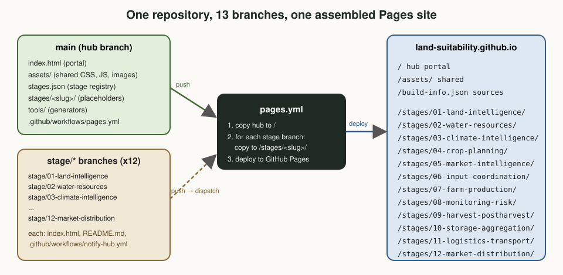
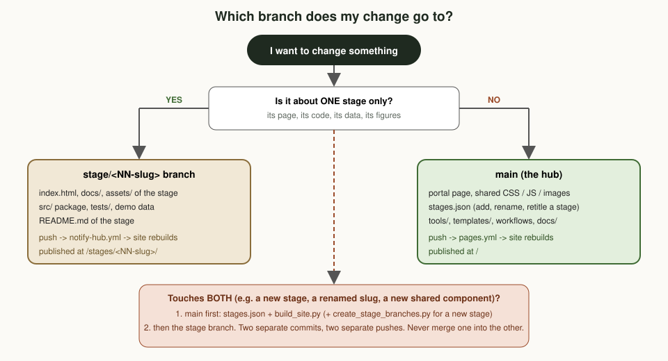

# Branch working rules

How to work with the 13 branches of this repository without breaking the website or each other's work.
Read this once fully; afterwards the **checklists** at the end are enough.

> **One-line summary.** Hub things go on `main`, stage things go on `stage/NN-slug`, the two never merge,
> every commit is authored as Getnet with no AI attribution, and `tools/check_branch.py` must pass before you push.

---

## 1. How the repository is organised

| Branch | Holds | Published at | Who changes it |
|---|---|---|---|
| `main` (default, the **hub**) | Portal page, shared design system (`assets/`), `stages.json`, `tools/`, `templates/`, workflows, these docs | `/` | Project lead, or anyone changing shared things |
| `stage/01-land-intelligence` … `stage/12-market-distribution` | Everything about **one** stage: `index.html`, `docs/`, `assets/`, `src/`, `tests/`, `README.md` | `/stages/<NN-slug>/` | The stage's working group |



**Analogy.** Think of a shopping mall. `main` is the building: corridors, signs, lighting, the directory
board (`stages.json`). Each stage branch is one shop. A shop decorates and stocks its own space but never
moves the corridors; the building manager never rearranges a shop's shelves. Opening a new shop means
first adding it to the directory board, then fitting out the space.

### Why branches instead of folders?

Each stage team can work, test and publish at its own pace. GitHub Pages only publishes one site per
repository, so `.github/workflows/pages.yml` on `main` assembles the hub and all twelve stage branches into
one site on every push (stage branches trigger it through `.github/workflows/notify-hub.yml`).
If a stage branch is missing, its placeholder page from `main/stages/<slug>/` is used instead.

---

## 2. Which branch does my change go to?



| I want to … | Branch | Notes |
|---|---|---|
| Edit a stage's page, code, tests, demo data or figures | `stage/<NN-slug>` | Only that stage's files |
| Change colours, fonts, header, footer, shared JS | `main` → `assets/css/site.css`, `assets/js/site.js` | Every stage page links these with absolute paths |
| Change a stage's title, summary, order or links on the portal | `main` → `stages.json`, then `python3 tools/build_site.py` | Never hand-edit between the `STAGE_GRID` markers in `index.html` |
| Add a new stage | `main` first (`stages.json`, build, `create_stage_branches.py --push`), then work on the new branch | See recipe 5.4 |
| Rename a stage slug | Avoid. If unavoidable, see recipe 5.5 | Breaks links and history |
| Change the deploy workflow or tools | `main` | Test with the local assembly check (5.6) |
| Fix a typo in a stage README | `stage/<NN-slug>` | Not on `main` |

---

## 3. The rules

**Rule 1: Only two kinds of branches.** `main` and `stage/NN-slug`. Short-lived feature branches are allowed
(`feature/<topic>` from `main`, or `stage/NN-slug--<topic>` from a stage branch), but they must be merged back into
**their own parent** and deleted afterwards. Do not leave helper branches (such as tool-generated working
branches) lying around once their content is on `main`.

**Rule 2: Stage branches are orphan branches and never merge with `main`.** They share no history with `main`
on purpose. Never run `git merge main` on a stage branch or `git merge stage/...` on `main`. If a stage needs a
shared change, make it on `main`; the stage picks it up automatically through the absolute `/assets/...` links.

**Rule 3: Hub-only files never appear on a stage branch.** `assets/css/site.css`, `assets/js/site.js`,
`stages.json`, `tools/`, `templates/`, `.github/workflows/pages.yml`. Stage-specific styles go in the stage's
own `assets/stage.css`.

**Rule 4: `stages.json` is the single source of truth.** The portal grid and placeholder pages are generated
from it. After any edit run `python3 tools/build_site.py` and commit the regenerated files in the same commit.

**Rule 5: Slugs are permanent.** A slug (`01-land-intelligence`) is part of the branch name, the URL and other
stages' links. Titles can change freely; slugs should not.

**Rule 6: Authorship and attribution.** Every commit is authored as `Getnet <getnetd24@gmail.com>`.
No `Co-Authored-By: Claude`, no `Claude-Session` links, no "Generated with Claude" lines in commits, pull
requests, issues or any pushed file. Set this once per clone:

```bash
git config user.name  "Getnet"
git config user.email "getnetd24@gmail.com"
```

**Rule 7: No personal data, ever.** The site is public. Households and plots use pseudonymous IDs only
(`HH-0001`, `P-0001-0`). No names, phone numbers, ID numbers, exact homestead coordinates or photos of people
without consent. Buyer contract terms are confidential. Demos use synthetic data and say so on the page.

**Rule 8: No history rewriting on shared branches.** No `git push --force` to `main` or any `stage/*` branch, and no
`git rebase` / `git commit --amend` on commits that are already pushed. If a pushed commit is wrong, fix it with a
**new** commit (or `git revert`). A rewrite needs explicit agreement from the project lead and must use
`git push --force-with-lease=<branch>:<expected-sha>`, never a bare `--force`.

**Rule 9: Check before you push.** `tools/check_branch.py` must pass (section 4). Tests on stage branches must pass
(`python3 tests/test_*.py`). Run the stage demo if you changed code, because pages read their charts from the
demo's JSON output in `assets/`.

**Rule 10: One logical change per commit, clear messages.** Subject line in the imperative, under about 70
characters (`Fill in stage 04: ...`, `Fix onset day bug in climate_intel`), then a short body saying what and why.

**Rule 11: Prose style.** No em dashes in page or document prose; partner organisations are written as
"potential partners" unless an agreement exists; no logos of other organisations.

**Rule 12: Never edit generated files by hand.** The `STAGE_GRID` block in `index.html` and `main/stages/<slug>/index.html`
placeholders come from `build_site.py`; stage chart data in `assets/demo-*.json` comes from `src/demo.py`.

---

## 4. The pre-push checker

`tools/check_branch.py` reads your clone and checks the rules above. It changes nothing (except regenerating
the hub grid on `main` if it was stale, which it then reports so you can commit it).

```bash
# on main
python3 tools/check_branch.py

# on a stage branch (the checker lives on main)
git fetch origin main
git show origin/main:tools/check_branch.py > /tmp/check_branch.py
python3 /tmp/check_branch.py
```

| Checked on | What it verifies |
|---|---|
| every branch | clean working tree; outgoing commits authored by Getnet; no forbidden attribution lines; no file over 5 MB; nothing that looks like a phone number |
| `main` | `stages.json` valid; grid and placeholders in sync; key files present |
| `stage/*` | slug registered in `stages.json`; root `index.html` and `notify-hub.yml` present; no hub-only files; shared stylesheet linked; branch is an orphan |

---

## 5. Recipes

### 5.1 First-time setup

```bash
git clone https://github.com/Land-Suitability/land-suitability.github.io.git
cd land-suitability.github.io
git config user.name "Getnet" && git config user.email "getnetd24@gmail.com"
```

### 5.2 Work on a stage

```bash
git fetch origin stage/04-crop-planning
git switch stage/04-crop-planning              # or: git worktree add ../s04 stage/04-crop-planning
# ... edit index.html, src/, tests/ ...
python3 tests/test_planner.py                  # stage tests
python3 src/demo.py                            # if code changed: refresh assets/demo-*.json
python3 -m http.server 8000                    # preview (open /index.html; shared CSS needs the hub, see 5.6)
git add -A && git commit -m "Describe the change"
python3 /tmp/check_branch.py                   # see section 4
git push
```

Tip: `git worktree` lets you keep `main` and several stages checked out side by side in separate folders,
which avoids accidentally committing to the wrong branch.

### 5.3 Change something shared (hub)

```bash
git switch main && git pull --ff-only
# ... edit assets/css/site.css, index.html (outside STAGE_GRID), tools/, docs/ ...
python3 tools/check_branch.py
git commit -am "Describe the change" && git push
```

### 5.4 Add a new stage

```bash
git switch main && git pull --ff-only
# 1. add the stage to stages.json (unique number, slug "NN-lowercase-words", domain, links)
python3 tools/build_site.py                    # regenerates grid + placeholder
git add -A && git commit -m "Register stage NN: <title>" && git push
# 2. create its orphan branch from the placeholder (never overwrites existing branches)
python3 tools/create_stage_branches.py --only NN-slug --push
```

### 5.5 Rename a stage (avoid if possible)

1. On `main`: change the slug in `stages.json` and every `upstream`/`downstream` reference; run `build_site.py`.
2. Create the new branch from the old one: `git push origin stage/OLD:refs/heads/stage/NEW`.
3. On the new branch: update links in `index.html` and the README; push.
4. Search all stage branches for links to `/stages/OLD/` and fix them.
5. Only after the site shows the new page: delete the old branch (`git push origin --delete stage/OLD`).

### 5.6 Preview the whole assembled site locally

```bash
mkdir -p /tmp/site && git archive origin/main | tar -x -C /tmp/site
for b in $(git ls-remote --heads origin 'stage/*' | awk '{print $2}' | sed 's#refs/heads/##'); do
  s=${b#stage/}; rm -rf /tmp/site/stages/$s; mkdir -p /tmp/site/stages/$s
  git fetch -q origin "$b" && git archive "origin/$b" | tar -x -C /tmp/site/stages/$s
done
cd /tmp/site && python3 -m http.server 8000     # open http://localhost:8000
```

### 5.7 Undo a mistake that is already pushed

```bash
git revert <bad-commit-sha>        # creates a new commit that undoes it
git push
```

---

## 6. Troubleshooting

| Symptom | Likely cause | Fix |
|---|---|---|
| Stage page still shows the placeholder | Branch name does not match the slug in `stages.json`, or the build has not run | Check `/build-info.json` on the site (`"source": "branch"`?); compare names; re-run the workflow from Actions |
| Pushed to a stage branch, site did not change | `notify-hub.yml` missing on the branch, or Actions disabled | Restore it from `main/templates/stage-branch/.github/workflows/`; check the Actions tab |
| Push to `main` builds but does not deploy | `main` is not the default branch (deploy only runs on the default branch) | Settings → General → Default branch = `main`; check with `git ls-remote --symref origin HEAD` (must say `refs/heads/main`) |
| Deploy job fails in about 2 seconds with no log | The `github-pages` environment only allows deploys from listed branches, and `main` is not on the list | Settings → Environments → `github-pages` → Deployment branches and tags: add `main` (and remove old working branches) |
| Page has no styling | Shared CSS linked with a relative path | Use `/assets/css/site.css` (leading slash) |
| Workflow warns "branch is not listed in stages.json" | A `stage/*` branch without a registry entry | Register it (5.4) or delete the branch |
| Chart shows old numbers | `assets/demo-*.json` not regenerated | Run `python3 src/demo.py` on the stage branch and commit |
| `check_branch.py` fails on author | Commit made before `git config` was set | If not yet pushed: `git commit --amend --reset-author --no-edit`; if pushed: leave it and fix the config for future commits |

---

## 6a. Writing a stage page that uses the shared features

Stage pages get extra features from `/assets/js/site.js` automatically if they keep the standard structure:

| Keep this in the stage page | You get |
|---|---|
| `<script src="/assets/js/site.js">` and `<link href="/assets/css/site.css">` | Palette search, theme, progress bar, back-to-top, shared logo |
| `<section class="stage-hero">` with a `.pill` | Stage illustration beside the hero, domain icon in the pill |
| `<nav class="toc">` with `<a href="#id">` chips and `<section id="...">` | Scroll spy highlighting the current section; sections become searchable |
| `<nav class="pager">` | Previous/next cards with illustrations |
| `<figure class="diagram"></figure>` | Click-to-enlarge lightbox |
| `<div class="table-wrap">` around wide tables | Keyboard-scrollable region |

Illustrations and social cards live on `main` (`assets/img/stages/`, `assets/img/social/`); regenerate them with
`python3 tools/make_stage_art.py` and `node tools/render_media.js`, never by hand.

## 7. Lessons from mistakes already made

These happened while the site was being built. Each one is now covered by a rule or the checker.

1. **The first branch pushed became the default branch.** Pushes to `main` then built the site but did not
   deploy it. → Troubleshooting row 3; `main` is now the default.
2. **AI attribution lines ended up in early commits** and had to be removed by rewriting history. → Rule 6,
   checked automatically.
3. **A history rewrite (force push) was needed** and correctly required explicit approval. → Rule 8:
   prevent it instead.
4. **A one-line `sed` edit silently did nothing** because the text spanned two lines; the demo kept using the
   old threshold. → After scripted edits, `grep` for the new value and re-run tests (Rule 9).
5. **A command chain (`a && b && c`) stopped half-way** after a harmless check failed, so a commit never
   happened. → Run important steps as separate commands and confirm with `git log -1`.
6. **Leftover working branch** (`claude/...`) stayed around after its content reached `main`. → Rule 1:
   delete helper branches once merged.
7. **A large JSON reformat produced a 343-line diff for a 12-line change.** → Edit data files minimally so
   reviews stay readable.
8. **A commit was made on a stale local `main`** (it had not been updated since an earlier push), so the push
   was rejected as non-fast-forward. → Always `git pull --ff-only` before starting work on a branch; if it
   happens to an unpushed commit, `git fetch && git rebase origin/main`, re-run the checker, then push.
   Never "fix" it with `--force`.
9. **The default branch did not change when expected.** Builds from `main` succeeded but every deploy job was
   skipped, because GitHub still reported the old working branch as default. → Verify settings changes with
   `git ls-remote --symref origin HEAD`, and check that the deploy job ran, not only the build.
10. **Changing the default branch was not enough.** The `github-pages` environment kept an allow-list that named
   only the old default branch, so the first deploy from `main` failed instantly with no log. → After changing
   the default branch, also update Settings → Environments → `github-pages` → Deployment branches and tags.

---

## 8. Checklists

**Before every push**
- [ ] I am on the right branch (`git branch --show-current`)
- [ ] Only files that belong to this branch changed (`git status`)
- [ ] Tests pass; demo re-run if code changed
- [ ] `check_branch.py` passes
- [ ] No personal data; synthetic data is labelled as synthetic

**Before merging a short-lived feature branch**
- [ ] It merges into its own parent (`main` or its stage branch), never across
- [ ] Checker passes on the parent after the merge
- [ ] Feature branch deleted afterwards

**Once per season (maintenance)**
- [ ] `/build-info.json` shows all 12 stages with `"source": "branch"`
- [ ] No stray branches (`git ls-remote --heads origin`)
- [ ] Repository settings: default branch `main`; Pages source "GitHub Actions"
- [ ] Optional protection on `main`: Settings → Branches → add a rule blocking force pushes and deletions
